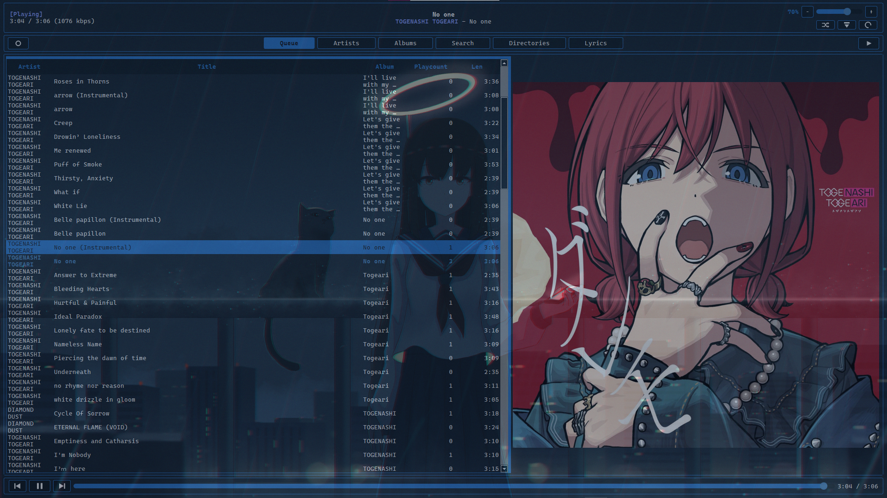

# JMPC (J Music Player Client)

Hey there! **JMPC** is a lightweight, and customizable desktop music player built with Python and PyQt6 (crafted with the help of AI).

This project was heavily inspired by the amazing [RMPC](https://github.com/mierak/rmpc) terminal client. Since there wasn't a native desktop version tailored for Windows with the exact aesthetic and smooth workflow I wanted, I decided to build JMPC as a fun hobby project

---
If I notice any bugs or want to add new features, I'll keep it updated!
---

## Features

* **Sleek Vector UI**: Custom-drawn vector icons using `QPainter` that adapt perfectly to themes without relying on messy fonts or emojis.
* **Theme Customization & Wallpaper Sync**: Choose from built-in presets (Catppuccin, Tokyo Night, Gruvbox, etc.) or sync your UI colors directly with your Windows desktop wallpaper.
* **YouTube Streaming & Downloading**: Stream audio directly from YouTube URLs or download them instantly as MP3s with embedded album art and metadata.
* **Live Audio Visualizer**: Integrated CAVA spectrum analyzer with multiple visual modes.
* **Synced Lyrics Support**: Automatic `.lrc` file detection alongside embedded lyrics support.
* **System Tray Minimization**: Clean background execution with quick tray controls.

---

## Screenshots

<p align="center">
  
</p>

---

## Keyboard Shortcuts

| Function | Shortcut |
| :--- | :--- |
| **Play / Pause** | `Space` |
| **Next / Previous Track** | `>` / `<` |
| **Volume Up / Down** | `+` / `-` |
| **Toggle Editor Mode** | `P` |
| **Toggle YouTube Bar** | `Y` |
| **Toggle Loop Mode** | `R` |
| **Toggle Random Mode** | `X` |
| **Toggle Consume Mode** | `C` |
| **Visualizer Style** | `V` |
| **Switch Tabs (1-6)** | `1` to `6` |
| **Fullscreen Toggle** | `Ctrl + F` |
| **Minimize to Tray** | `Ctrl + Q` |

---

## Getting Started (For Developers)

If you want to run or tweak the source code locally:

1. Clone the repository:
   ```bash
   git clone [https://github.com/YourUsername/jmpc.git](https://github.com/SeLyrl/jmpc.git)
   cd jmpc
